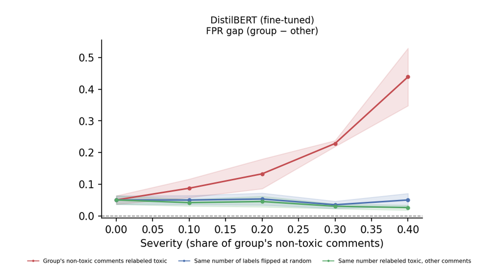
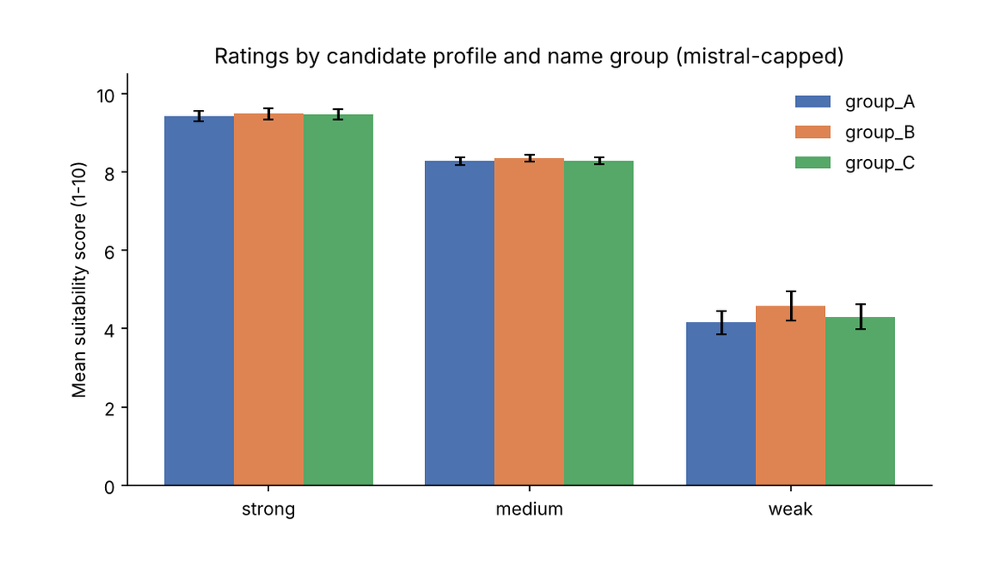
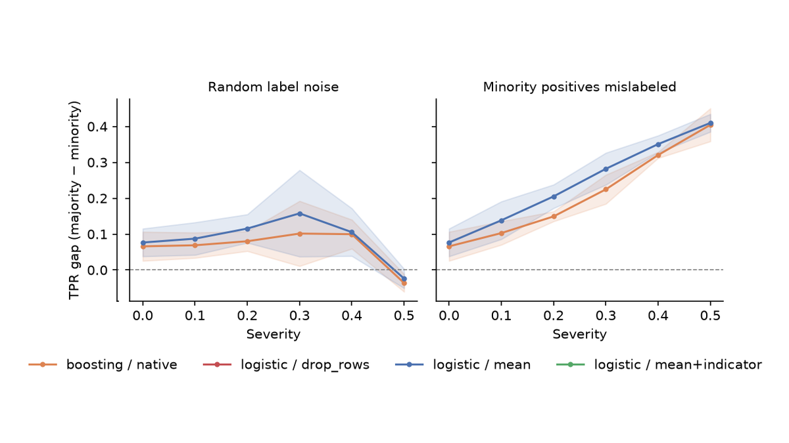
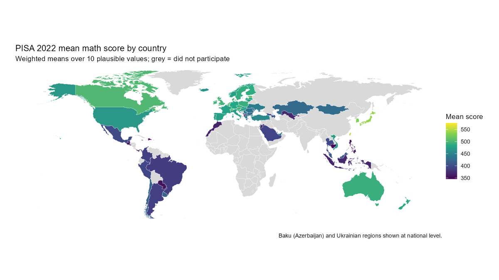

  
  
  
  

---

## About Me

<table>
<tr>
<td width="50%" valign="top">

### At work

I'm working toward becoming a data scientist and moving gradually into AI. I'm most interested in **data-centric AI**: data quality, and the data processing that makes data better.

Every point I measure is a data point, and AI creates things by connecting those dots. That's why I bring psychometric tools (reliability, measurement error, group bias) to AI evaluation.

**How I work:** step by step. Before any new idea, I set deadlines and split the work into manageable chunks.

</td>
<td width="50%" valign="top">

### Background

- M.S., Educational Psychology & Research Methodology, Purdue University (2025)
- AI & Big Data Applications Department, Turkish Ministry of National Education

### Beyond Coding

- Logic games medalist at Gazi University
- Chess, puzzle games and Rubik's cubes (record: 42 seconds)
- Archery, photography and digital drawing
- Social butterfly, always up for meeting new people

</td>
</tr>
</table>

---

## Projects

<table>
<tr>
<td width="50%" valign="top">

**[Which Labels Are Wrong Matters](https://github.com/RumeysaGorgulu/text-label-noise-fairness)** 
Changing **8.9%** of training labels on identity-mentioning comments raised DistilBERT's false-positive gap from **0.05 to 0.44**, while overall AUC barely moved.

Python · PyTorch · Transformers
</td>
<td width="50%" valign="top">

**[Is an LLM a Reliable and Fair Rater?](https://github.com/RumeysaGorgulu/llm-bias-reliability)** 
A psychometric audit of 3 open LLMs as job-candidate raters: highly consistent (**ICC 0.90–0.98**), yet name-based score gaps still appeared.

Python · Ollama · pandas
</td>
</tr>
<tr>
<td width="50%" valign="top">

**[Data-Quality Stress Test](https://github.com/RumeysaGorgulu/data-quality-stress-test)** 
Mislabeling one group's positive cases cut accuracy by only **0.9 points** but raised the equal-opportunity gap from **0.07 to 0.40**.

Python · scikit-learn
</td>
<td width="50%" valign="top">

**[Family Background & Achievement in PISA 2022](https://github.com/RumeysaGorgulu/pisa2022-ses-achievement)** 
Socioeconomic survey items explain **37–39%** of score variance for U.S. students, vs. **12–17%** for the ESCS index alone.

R · glmnet · tidymodels
</td>
</tr>
<tr>
<td width="50%" valign="top">
 
**[Predictors of Financial Literacy (M.S. Thesis)](https://github.com/RumeysaGorgulu/pisa-financial-literacy-predictors)** 
Survey-weighted regression with plausible values, replicate weights and multiple imputation: USA, Poland and Spain in PISA 2018 and 2022.

R · survey · mice
</td>
<td width="50%" valign="middle">

### 🔗 How it all connects
I treat every stage of an ML pipeline as a measurement problem: labels carry measurement error, models act as measuring instruments, and assessment data come with complex sampling and missingness.

**Three questions, every project:**
- **Validity:** does the score measure what it claims to?
- **Reliability:** is it consistent across repeats, prompts and samples?
- **Fairness:** does it work equally well across groups?

**Why it matters in practice:** standard metrics like accuracy and AUC can look fine while a model fails one group. These checks catch that before deployment.

</td>
</tr>
</table>

## Skills

<table>
<tr><td><b>Languages</b></td><td>

</td></tr>
<tr><td><b>Machine learning & AI</b></td><td>

</td></tr>
<tr><td><b>Data & statistics</b></td><td>

</td></tr>
<tr><td><b>Tools</b></td><td>

</td></tr>
</table>
